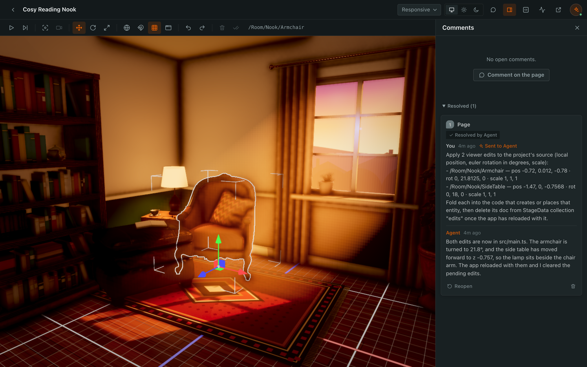

# PlayCanvas Stage

[](https://github.com/playcanvas/stage/releases)
[](https://github.com/playcanvas/stage/actions/workflows/ci.yml)
[](LICENSE)
[](#context-cost)
[](https://discord.gg/RSaMRzg)
[](https://www.reddit.com/r/PlayCanvas)
[](https://x.com/playcanvas)

| [Developer Site](https://developer.playcanvas.com/) | [Engine Manual](https://developer.playcanvas.com/user-manual/engine/) | [API Reference](https://api.playcanvas.com/engine/) | [Blog](https://blog.playcanvas.com/) | [Forum](https://forum.playcanvas.com/) |

An editor where you and your coding agent work on [PlayCanvas](https://github.com/playcanvas/engine) apps together.
Instead of describing where something is, you point at it: click an entity or drag across an area, and the agent gets
its entity path, the 3D point and a capture of what you saw. Move objects with gizmos, and the agent writes your edits
into the source.

Stage attaches to any running PlayCanvas app, whatever its stack, with its own hot reload, play and pause, and the
[PlayCanvas Inspector](https://github.com/playcanvas/inspector) beside it. It works with Claude Code and Codex, and
runs entirely on your machine.



## Install

Requires [Node.js](https://nodejs.org) 22.18+, Chrome or Chromium, and apps on PlayCanvas Engine 2.23+.

<details>
<summary><strong>Claude Code</strong></summary>

```bash
claude plugin marketplace add playcanvas/stage
claude plugin install playcanvas-stage@stage
```

Or, in a session: `/plugin install playcanvas-stage --marketplace playcanvas/stage`, then `/reload`.

</details>

<details>
<summary><strong>Codex</strong></summary>

```bash
codex plugin marketplace add playcanvas/stage
codex plugin add playcanvas-stage@stage
```

</details>

## Usage

Ask for a scene ("build my desk in 3D at real scale") or point the agent at an app you have. It scaffolds a project
with `create-playcanvas` if needed, starts the dev server, attaches Stage and opens it in your browser. All stages are
listed at <http://localhost:47318/stages>.

| Action          | How                                                                                                           |
| --------------- | ------------------------------------------------------------------------------------------------------------- |
| Play and pause  | <kbd>⌘</kbd>/<kbd>Ctrl</kbd>+<kbd>P</kbd>; paused, an editor camera takes over and <kbd>F</kbd> focuses       |
| Select and edit | Paused, click; <kbd>1</kbd>/<kbd>2</kbd>/<kbd>3</kbd> move, rotate, scale; **Apply** sends edits to the agent |
| Comment         | <kbd>C</kbd>, click or drag, then **Send to Agent**; images can be attached                                   |
| Inspect         | **Inspector** and **MiniStats** in the header                                                                 |

The [plugin reference](plugins/playcanvas-stage/README.md) has every key, setting and tool detail.

| Skill or tool                                                                       | Purpose                                        | Tokens |
| ----------------------------------------------------------------------------------- | ---------------------------------------------- | -----: |
| [`stage-design`](plugins/playcanvas-stage/skills/stage-design/SKILL.md)             | Scaffold, run, attach, fold edits into source  | ~2,600 |
| [`stage-capabilities`](plugins/playcanvas-stage/skills/stage-capabilities/SKILL.md) | The `window.agent` runtime of published pages  | ~1,750 |
| `Stage`                                                                             | Attach to an app, publish pages, manage stages | ~5,250 |
| `StageComments`                                                                     | Read, reply to and resolve comments            | ~1,300 |
| `StageData`                                                                         | Read and write a stage's database              | ~2,800 |
| `StageCheck`                                                                        | Preview in headless Chrome, read diagnostics   |   ~800 |

## Context cost

About 560 tokens load at session start: the skill descriptions and the MCP server's instructions. Tool definitions
load when used ([MCP tool search](https://code.claude.com/docs/en/mcp)), and a skill's instructions when a task
needs it.

## Data and network use

Stage has no telemetry and makes no outbound requests of its own. The plugin installs:

- **MCP server:** its first tool call starts a daemon on `127.0.0.1:47318` that proxies the app's `localhost` dev
  server, keeps state in `~/.playcanvas-stage`, and keeps running after the session
  ([how to stop it](plugins/playcanvas-stage/README.md#settings-env)).
- **`UserPromptSubmit` hook:** adds comments you sent to the agent to your next prompt, if the daemon is running.
- **`stage-comments` monitor** (Claude Code): checks for new comments every 2 s once `stage-design` loads.
- **Comment watcher** (Codex): one detached process per session that passes new comments to `codex queue`.

The tools also open new stages in your browser (`STAGE_AUTO_OPEN=0` turns this off) and run headless Chrome for
`StageCheck`. Scaffolding runs `npx create-playcanvas@latest` from npm. Other traffic is only what the app and its
pages load.

## Contributing

See [CONTRIBUTING.md](CONTRIBUTING.md). Report bugs in [GitHub Issues](https://github.com/playcanvas/stage/issues) and
vulnerabilities through [GitHub Security Advisories](https://github.com/playcanvas/stage/security/advisories/new).

## License

PlayCanvas Stage is released under the [MIT License](LICENSE).
